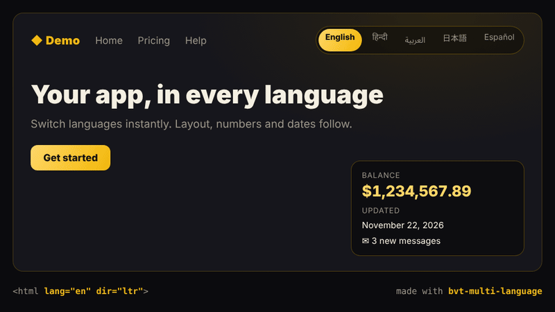
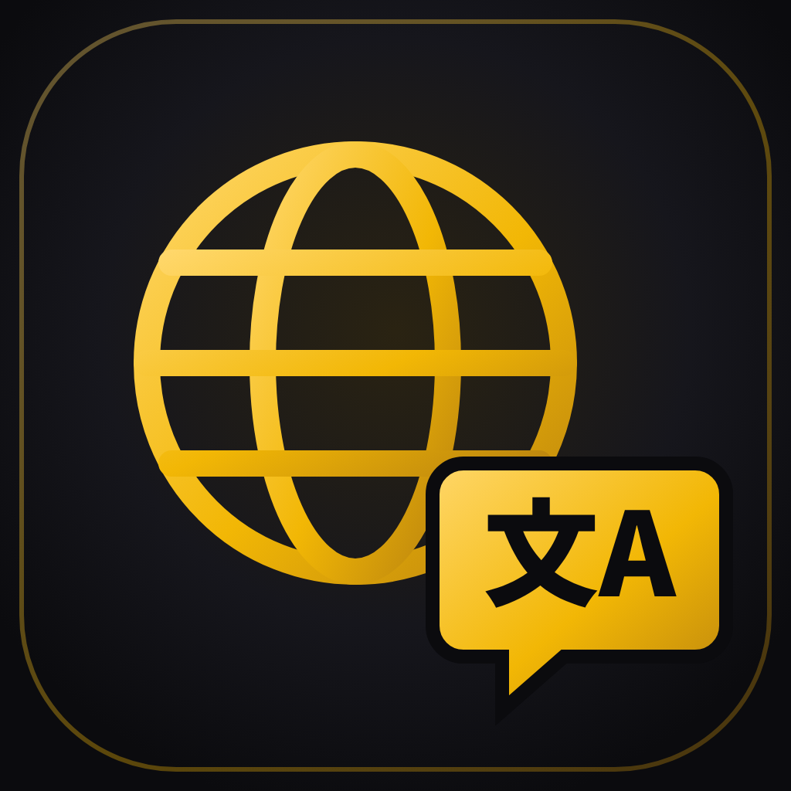
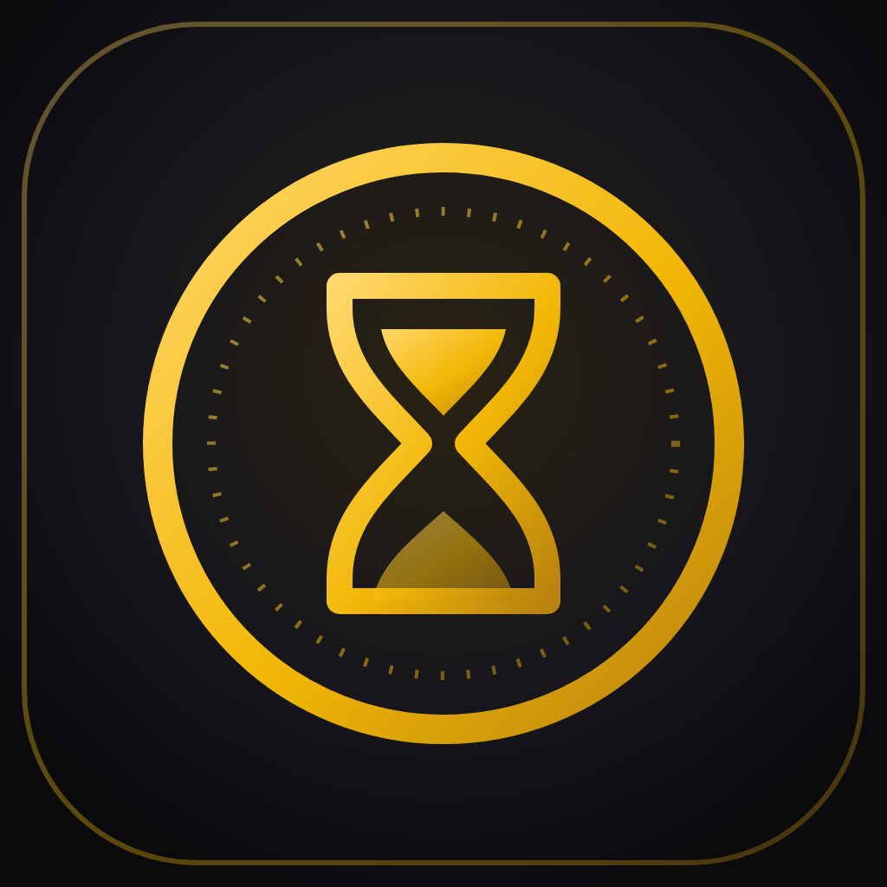
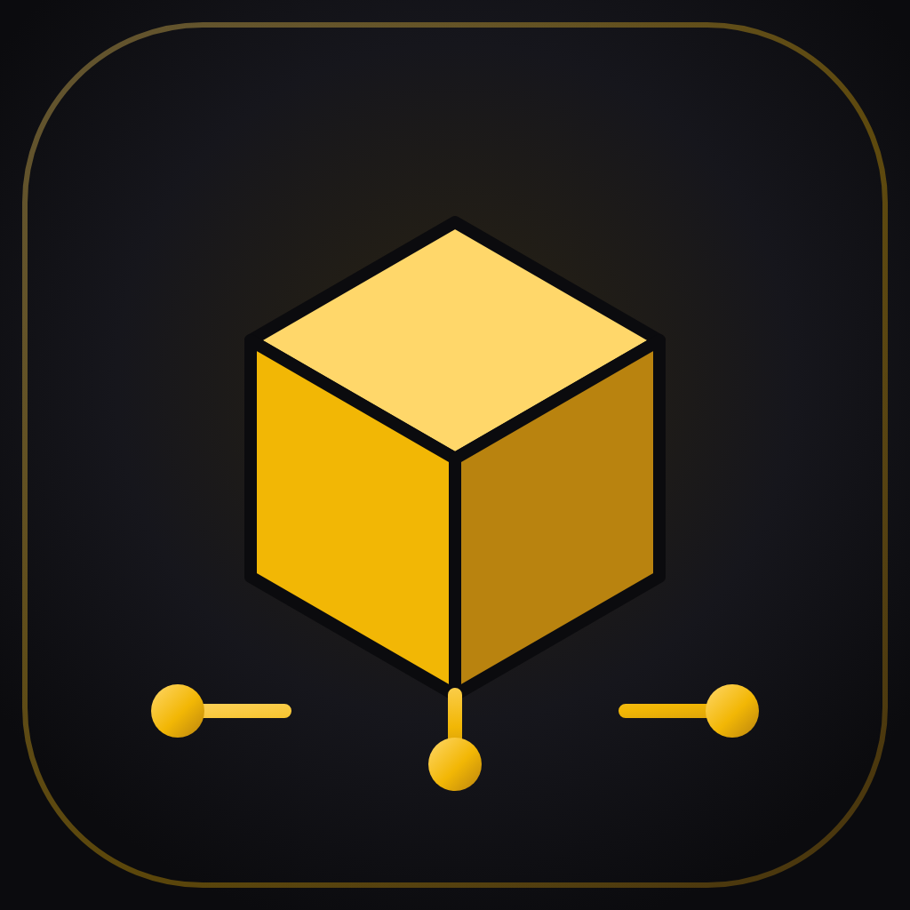
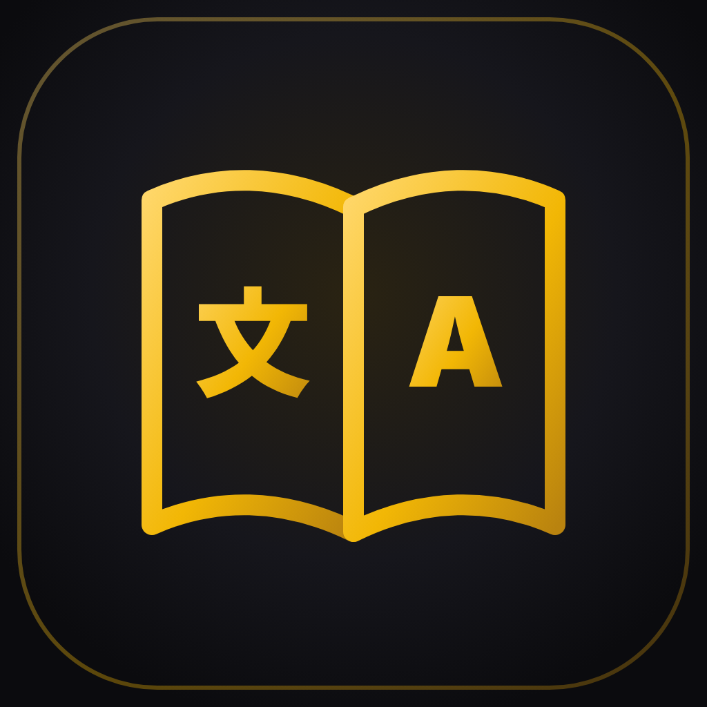
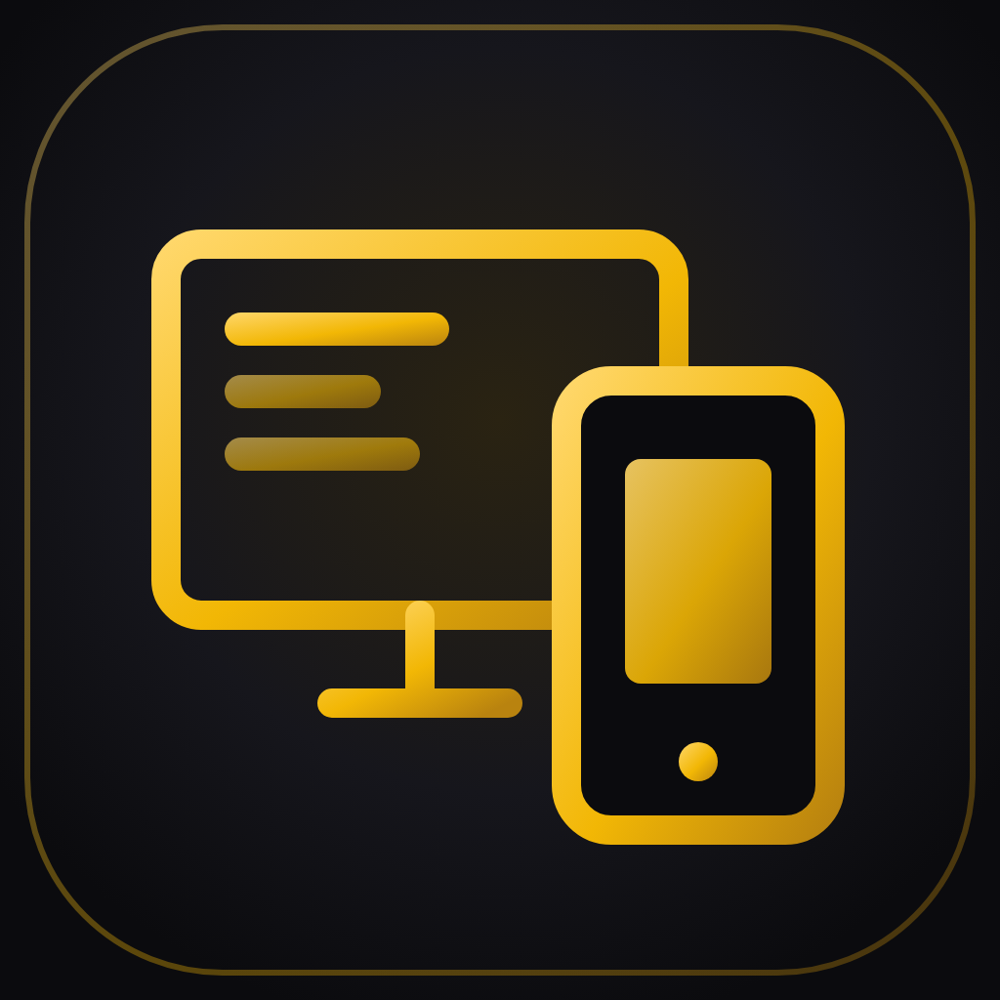

<p align="center">
  
</p>

# BVT Skills

**Free Claude Code plugins: make any app multilingual with one prompt, make your Claude usage last longer, and build crypto apps the safe way, with 50+ engineering playbooks.**

[](LICENSE)
[](#install)
[](https://github.com/bitvault-developers/bvt-skills/releases)
[](https://github.com/bitvault-developers/bvt-skills/stargazers)

Made by the [BitVault](https://bitvault.club) team. If one of these saves you time, a ⭐ helps other people find it.

## Quick start

Run this in your terminal:

```bash
claude plugin install bvt-multi-language --marketplace bitvault-developers/bvt-skills
```

Then open your project in Claude Code and ask:

> Add a language switcher to this app with English, Hindi, Arabic, Japanese and Spanish.

Claude sets up the translation files, the switcher, right-to-left layout for Arabic, and local number and date formats, then checks the result.

## Plugins

| | Plugin | What it does | Try asking |
|---|---|---|---|
|  | **[bvt-multi-language](plugins/bvt-multi-language)** | Adds a language switcher and a full multilingual system to any website or app (React, Next.js, Vue, Svelte, Angular, Flutter, FlutterFlow, React Native, Android, iOS, Electron, Tauri, WordPress), translates it into as many languages as possible, and checks quality before release. Comes with 7 ready scripts. | "Translate this app into 40 languages and check nothing is broken." |
|  | **[bvt-save-token](plugins/bvt-save-token)** | Makes your Claude usage last longer: short replies, diff-only code, handoff notes for fresh chats, and an audit of what to switch off. | "BVT SAVE TOKEN: audit my setup." |
|  | **[bvt-crypto-architecture](plugins/bvt-crypto-architecture)** | Two architecture playbooks: a centralized crypto exchange (ledger first, single-writer matching engine, safe build order) and a self-custody wallet (seed phrase, encrypted storage, 2FA, send flow) for web, mobile and browser extensions. | "Plan the ledger and matching engine for my exchange." |
|  | **[bvt-i18n-playbooks](plugins/bvt-i18n-playbooks)** | 15 localization playbooks: i18n architecture, ICU plurals, right-to-left layout, fonts for Hindi, Arabic and CJK, local number, currency and date formats, seed phrase language rules, store listings, legal translation, AI translation QA and testing. | "Set up ICU plurals and lakh number format for Hindi." |
|  | **[bvt-app-playbooks](plugins/bvt-app-playbooks)** | 29 engineering playbooks for crypto wallet and exchange apps: secure storage, biometrics and 2FA, seed phrase screens, RPC failover, React Native and Expo, Tauri desktop, PWA, push privacy, testing, iOS builds without a Mac, and store release. | "Build the seed phrase backup screen with screenshot protection." |
|  | **[bvt-chain-ops](plugins/bvt-chain-ops)** | 6 operations playbooks: Solidity with OpenZeppelin, multisig plus 48-hour timelock governance, PoW multi-algorithm L1, cloudflared and nginx edge, incident runbooks and project docs. | "Review this contract against the Solidity standard." |

## Install

### Claude Code

Inside Claude Code:

```text
/plugin marketplace add bitvault-developers/bvt-skills
/plugin install bvt-multi-language@bvt-skills
/plugin install bvt-save-token@bvt-skills
/plugin install bvt-crypto-architecture@bvt-skills
/plugin install bvt-i18n-playbooks@bvt-skills
/plugin install bvt-app-playbooks@bvt-skills
/plugin install bvt-chain-ops@bvt-skills
```

Or from your terminal, one plugin per line:

```bash
claude plugin install bvt-multi-language --marketplace bitvault-developers/bvt-skills
claude plugin install bvt-save-token --marketplace bitvault-developers/bvt-skills
claude plugin install bvt-crypto-architecture --marketplace bitvault-developers/bvt-skills
claude plugin install bvt-i18n-playbooks --marketplace bitvault-developers/bvt-skills
claude plugin install bvt-app-playbooks --marketplace bitvault-developers/bvt-skills
claude plugin install bvt-chain-ops --marketplace bitvault-developers/bvt-skills
```

Install only the ones you need. Update later with `/plugin marketplace update bvt-skills`.

### Claude app (web, desktop, mobile)

1. Download the zip for the skill you want from the [latest release](https://github.com/bitvault-developers/bvt-skills/releases/latest) or the [`dist`](dist) folder. There is one zip per skill, named after it (for example `bvt-multi-language.zip` or `bvt-seed-phrase-ux.zip`).
2. In Claude's settings, go to where you add skills and upload the zip.
3. Start a new chat. Claude uses the skill on its own when your request matches it.

### Other AI coding agents

Each skill is a plain folder with a `SKILL.md` file (the open Agent Skills format). Install them all with:

```bash
npx skills add bitvault-developers/bvt-skills
```

or copy a folder from `plugins/<plugin>/skills/` into your agent's skills folder.

## Good to know

- **Made for everyone.** Every skill is free and public under the MIT license. The playbooks started as the BitVault team's own rules and were rewritten to be generic: swap the example tokens, chains and app names for your own.
- **Nothing runs by itself.** The scripts in bvt-multi-language run only when you or Claude run them, and every paid translation run prints a cost estimate and waits for a yes.
- **Your keys stay yours.** Translation API keys are read from environment variables, never written into code or files.
- **Guidance, not a guarantee.** The architecture, app and chain playbooks are engineering guidance. They are not a security audit and not legal advice: have a real exchange or wallet audited, and check the law in every country you serve.

## Contributing

Issues and pull requests are welcome: a recipe for your framework, a glossary for your language, or a fix. See [CONTRIBUTING.md](CONTRIBUTING.md). Questions and ideas go in [Discussions](https://github.com/bitvault-developers/bvt-skills/discussions). Changes are listed in [CHANGELOG.md](CHANGELOG.md).

## Security

Found a security problem? Email support@bitvault.club instead of opening a public issue. See [SECURITY.md](SECURITY.md).

## License

[MIT](LICENSE) © 2026 BitVault Founding Team. Not affiliated with or endorsed by Anthropic. Claude is a trademark of Anthropic.
